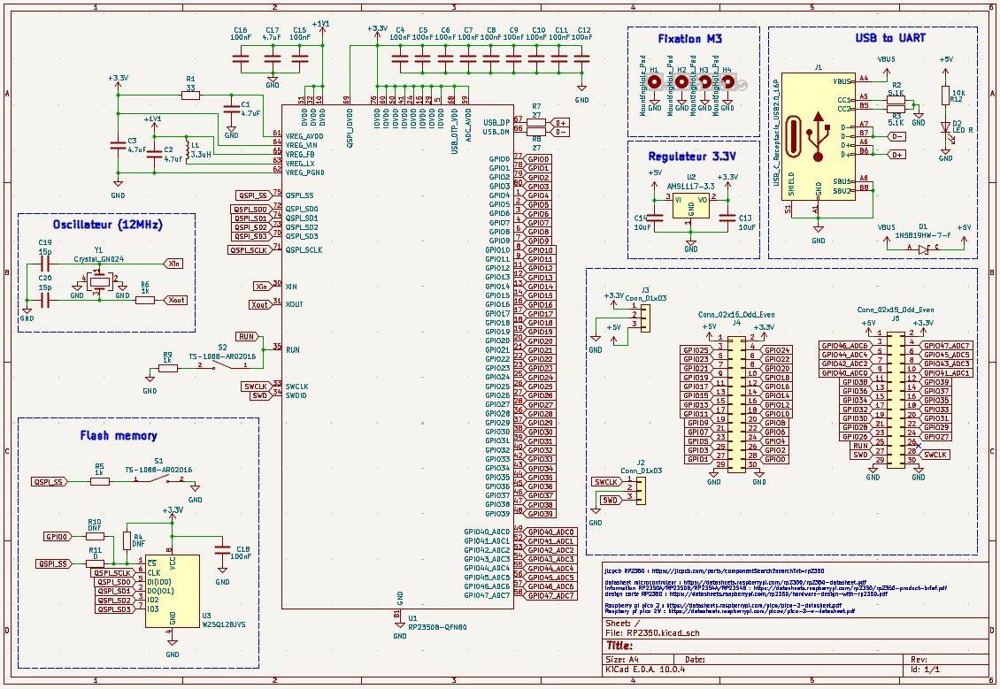
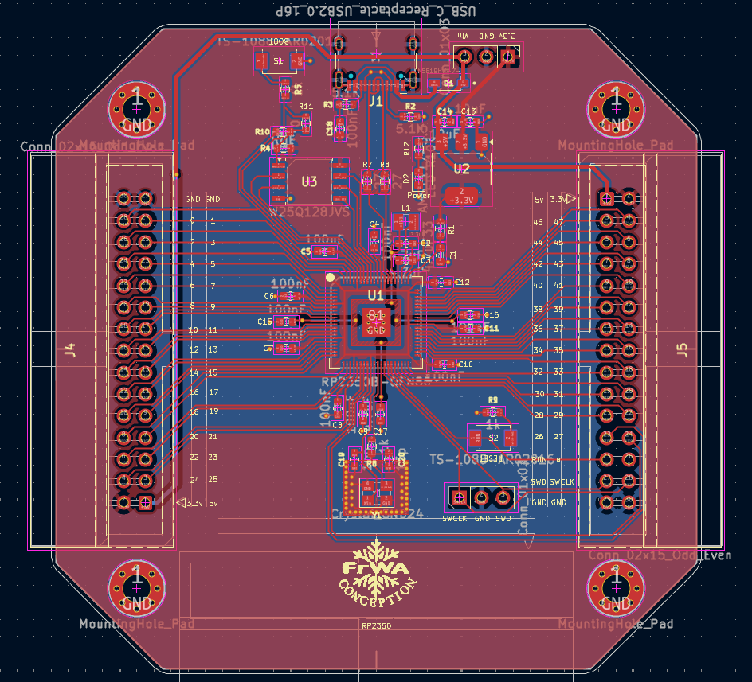
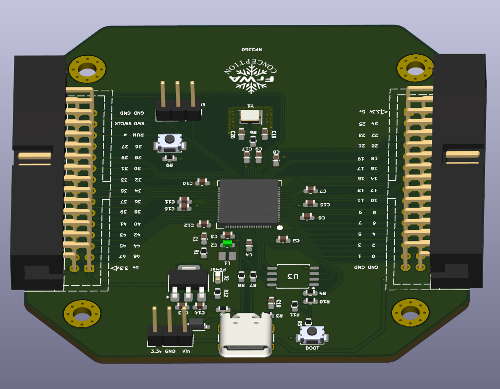

# Carte de développement RP2350B

Carte basée sur le microcontrôleur RP2350B (QFN-80) de Raspberry Pi, conçue sous KiCad 10.

## Modèle 3D

- [`RP2350.stl`](RP2350.stl) : cliquer dessus pour faire tourner la carte en 3D directement
  sur GitHub.
- [`RP2350.step`](RP2350.step) : modèle complet (carte et composants) pour FreeCAD,
  Fusion 360, SolidWorks, etc.

## Ouvrir le projet

Ouvrir `RP2350.kicad_pro` avec KiCad 10. Le projet est autonome : aucune bibliothèque
à installer.

- `libs/RP2350.kicad_sym` : tous les symboles du schéma.
- `libs/RP2350.pretty` : toutes les empreintes du PCB.
- `libs/3dmodels` : les modèles 3D, liés via `${KIPRJMOD}`.

Les tables `sym-lib-table` et `fp-lib-table` du projet déclarent ces bibliothèques en
chemin relatif.

L'inductance L1 (empreinte 0806) utilise le modèle 3D d'une 0805 (`L_0805_2012Metric`).

## Fabrication

Le dossier `production/` contient les fichiers pour JLCPCB : `RP2350_corrected.zip`
(Gerbers et perçages, avec sérigraphie couleur), `bom.csv`, `positions.csv`, ainsi que
les aperçus des deux faces.

La sérigraphie couleur est générée avec le plugin Fabrication Toolkit Color. Ses réglages
sont dans `fabrication-toolkit-options.json` et les images sources dans `Image/`.
À la commande : PCB blanc, finition ENIG, option « EasyEDA multi-color silkscreen ».

## Licences des bibliothèques

Le symbole, l'empreinte et le modèle 3D du RP2350B viennent de la bibliothèque
RP2350_KiCad, sous licence GPL v3 (`libs/licences/`). Les autres composants viennent des
bibliothèques officielles de KiCad ou des fabricants.
